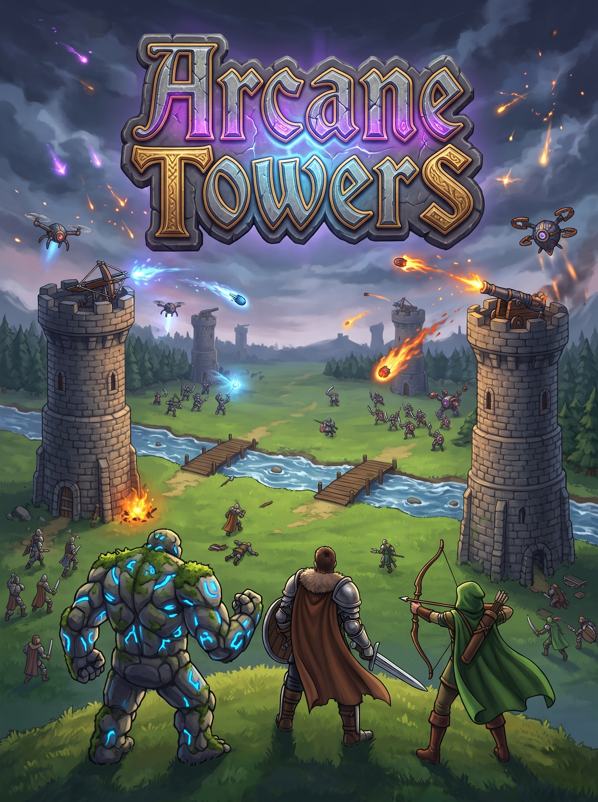

# Arcane Towers

**Arcane Towers** — динамічна стратегічна тактична 2D-гра у реальному часі (у стилі Clash Royale / Tower Defense) для вертикальних екранів (формат 9:16). Гравці керують колодою магічних карт, накопичують ману (краплі енергії) та призивають юнітів і застосовують заклинання на полі бою, щоб захистити власну фортецю й знищити вежі супротивника.

---

## 🎮 Короткий опис ігроладу

- **Мета гри:** Знищити головну фортецю ворога або знести більше бічних башт за 4 хвилини.
- **Енергія (Мана):** Накопичується автоматично від 0 до 10 одиниць. Відображається у вигляді лічильника `X/10` та 10 крапель енергії. В останню хвилину матчу швидкість відновлення мани подвоюється (x2).
- **Колода:** У гравця є 4 активні карти в руці та черга карт. Розіграна карта замінюється наступною.
- **Поле бою:** Розділене річкою з двома мостами. Наземні війська рухаються через мости, авіація летить навпростець, а заклинання діють у будь-якій точці карти.
- **Супротивник:** Автономний штучний інтелект (AI), який накопичує енергію та тактично виставляє юнітів для контратаки.

---

## ⚙️ Технічний опис проєкту

- **Ігровий рушій:** Unity 6 / Unity 2022+ (2D)
- **Роздільна здатність:** Фіксований портретний формат 9:16 (1080×1920) із скриптом адаптивності [`ArcaneCameraAspect`](Assets/Scripts/ArcaneCameraAspect.cs).
- **Архітектурний принцип:** Повне розділення логіки та даних (**Separation of Concerns**). У C# скриптах знаходиться виключно функціонал, а всі візуальні параметри, координати, HP, урон, швидкості та спрайти зберігаються у **Префабах (`Assets/Prefabs/`)**.

---

## 🏗️ Структура префабів (Модульні блоки)

Сцена `ArcaneTowers.unity` зібрана з 5 незалежних модульних префабів:

| Префаб | Опис та вміст |
| :--- | :--- |
| **`[ARENA].prefab`** | Поле бою: підкладка карти (`map.png`), стежки (`road.png`), річка (`River_Water`), мости (`Bridge_Left`, `Bridge_Right`) та атмосферний градієнт зверху поля (`arena_gradient.png`). |
| **`[TOWERS].prefab`** | 6 веж на полі бою: по 2 бічні башти та 1 головна фортеця для кожного гравця з компонентом [`ArcaneTower.cs`](Assets/Scripts/ArcaneTower.cs). |
| **`[UI CANVAS].prefab`** | Користувацький інтерфейс (9:16): верхній таймер, лічильник мани з 10 краплями енергії, нижня дерев'яна панель колоди з 4 слотами карт, прев'ю наступної карти та фінальне вікно перемоги/поразки. |
| **`[MANAGEMENT].prefab`** | Центральний вузол логіки: містить менеджери [`ArcaneGameManager`](Assets/Scripts/ArcaneGameManager.cs), [`ArcaneDeckManager`](Assets/Scripts/ArcaneDeckManager.cs), [`ArcaneAudio`](Assets/Scripts/ArcaneAudio.cs) та шаблон бійця `Unit_Template`. |
| **`Main Camera.prefab`** | Ортографічна камера з автопідгонкою співвідношення сторін та аудіо-слухачем (`AudioListener`). |

---

## 🧩 Огляд скриптів (`Assets/Scripts/`)

```text
Assets/Scripts/
├── ArcaneData.cs           # Базові структури (CardInfo, інтерфейс IDamageable, Enums)
├── ArcaneGameManager.cs    # Логіка матчу, таймер, регенерація енергії, AI суперника
├── ArcaneDeckManager.cs    # Управління колодою, слоти карт, розміщення юнітів на полі
├── ArcaneUnit.cs           # Поведінка бійців: рух через мости, пошук цілей, атака, колізія
├── ArcaneTower.cs          # Логіка веж: стрільба снарядами, радіус атаки, смужка HP
├── ArcaneSpell.cs          # Заклинання: вибух Вогняної кулі та Лікування союзників
├── ArcaneProjectile.cs     # Самонавідні снаряди для лучників, веж та дронів
├── ArcaneHealthBar.cs      # Рендеринг чітких смужок здоров'я з контрастною рамкою
├── ArcaneVisuals.cs        # Покадрова анімація бігу, атаки, смерті та тіні юнітів
├── ArcaneAudio.cs          # Аудіосистема: відтворення ефектів, спавнів, атак і музики
└── ArcaneCameraAspect.cs   # Фіксація пропорцій 9:16 на будь-яких екранах
```

---

## 🃏 Карти та бойові одиниці

Усі характеристики карт налаштовуються в Інспекторі префаба `[MANAGEMENT].prefab` (у списку `Initial Deck`):

1. **Воїн (Warrior)** — вартість: 3 мани. Ближній бій, надійний танк із мечем для оборони та штурму.
2. **Лучник (Archer)** — вартість: 3 мани. Дальній бій, атака наземних і повітряних цілей самонавідними стрілами.
3. **Голем (Golem)** — вартість: 5 мани. Важкий гігант із великим запасом HP. Атакує **виключно будівлі та вежі**, ігноруючи бійців.
4. **Дрон (Drone)** — вартість: 4 мани. Повітряний бойовий дрон. Летить над водою навпростець, атакує з дистанції.
5. **Вогняна куля (Fireball)** — вартість: 4 мани. Заклинання радіусного ураження по ворожих бійцях та вежах.
6. **Лікування (Heal)** — вартість: 3 мани. Заклинання відновлення здоров'я союзних військ у зоні дії.

---

## 🔊 Звуки та графіка

- **Аудіо:** 16 оптимізованих треків у `Assets/Audio/` (фонова бойова музика, озвучення спавну кожного персонажа, звуки ударів і пострілів, постріли та руйнування веж, касти заклинань і кліки інтерфейсу).
- **Спрайти:** Уся 2D-графіка зберігається в `Assets/Sprites/` з покадровими анімаціями бігу (`run`), бою (`attack`) та загибелі (`die`) для обох сторін (`from` — гравець, `to` — ворог).
